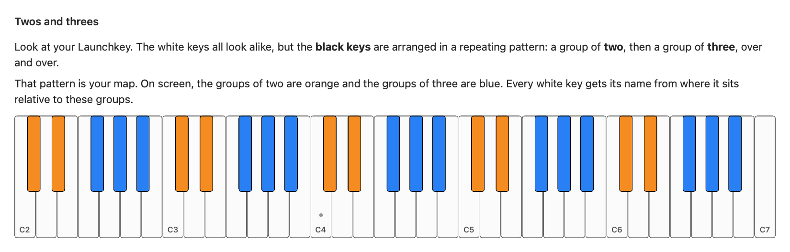
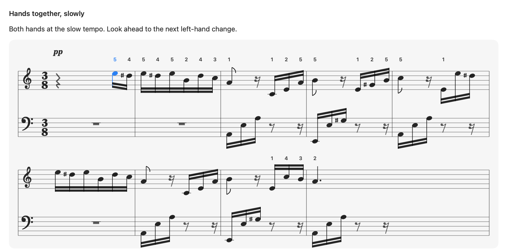
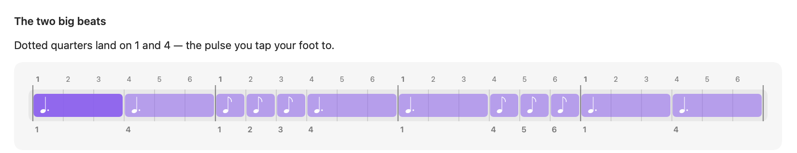

# Piano Coach

A native macOS app that teaches piano through a MIDI keyboard. Plug in a controller, pick a lesson, and the app shows the whole keyboard on screen, lights up the keys to play, listens to what you play, and scores it.

It was built for the 61-key **Novation Launchkey 61**, and works with any MIDI keyboard that macOS can see.



## What it does

- **Shows the full 61-key keyboard** (C2–C7) and lights the keys for each step: blue for the right hand, orange for the left, with finger numbers on the keys.
- **Listens over MIDI** and marks each note green or red as you play.
- **Walks you through 330 lessons** that mix short explanations, a Listen/Demo button, and scored playing tasks.
- **Teaches singing too**: a Voice section listens through the microphone, draws the pitch of your voice against the notes to sing, and scores how in tune you are. A Voice studio adds a live tuner, recording and Auto-Tune.
- **Plans your practice**: a Today screen builds a 15–20 minute session from a warm-up, lessons due for review (spaced repetition), and what's next.
- **Scores what a teacher would listen for:**
  - note accuracy and wrong notes
  - timing in milliseconds, including whether you rush or drag
  - tempo steadiness
  - velocity evenness and dynamics (pp to ff, crescendo, accents)
  - legato and staccato, measured from key release times
  - voicing (top note of a chord louder) and balance between hands
  - sustain-pedal changes
- **Draws real notation**: treble, bass and grand staff with key signatures, accidentals, beams, slurs, repeats, ornaments, dynamics and fingering, plus a rhythm timeline with a moving playhead.
- **Falling notes**: notes drop onto the on-screen keys and land when they should be played.
- **Practice aids on every timed task**: one hand at a time while the app plays the other, a wait mode that pauses on each note, and looping a few bars with automatic speed-up.
- **Imports your own songs** from MIDI or MusicXML files and turns them into lessons.
- **Household profiles**: each person has their own progress, history and daily plan.
- **Progress dashboard**: charts of practice time, accuracy, timing and evenness over weeks.
- **Plays a piano sound** through the Mac, since a MIDI controller makes no sound of its own, and a sample-accurate metronome with a count-in.
- **Saves progress**: stars per lesson and the best clean tempo for each timed task.






## Install and run

Requirements: macOS 14 or later and the Xcode Command Line Tools (`xcode-select --install`). Full Xcode is not needed.

```sh
git clone https://github.com/redbotster/piano-coach.git
cd piano-coach
scripts/build-app.sh --open
```

This builds `build/Piano Coach.app` and opens it. Drag the app to `/Applications` if you want to keep it.

The build is ad-hoc signed, not notarized, so it is meant to be built on the Mac that runs it.

## Using it

1. Connect the keyboard by USB. The toolbar shows a green dot and the device name when it is detected.
2. Start from **Today** for a suggested session, or choose any lesson in the sidebar.
3. Read each step, press **Listen** or **Demo** to hear it, then play. The demo counts in, then the notes scroll down onto the keys as they sound, so you can play along; nothing is scored while a demo plays.

There are two kinds of playing task:

| Kind | How it works |
|---|---|
| **Untimed** | The lesson waits for you. Play the lit keys in order at your own pace. |
| **Timed** | Press **Start** (or Space). After a count-in, play along with the metronome while the playhead moves. Use the BPM − / + buttons to slow down or speed up. |

After each task you get a result card with the numbers and one to three stars.

A lesson is marked complete when you finish its last step. You can also mark or unmark any lesson yourself: use the **Mark complete** button in the lesson header, right-click the lesson in the sidebar, or press `⌘K`. Unmarking keeps the stars you earned.

### Practice aids

Under every timed task:

| Option | What it does |
|---|---|
| **Hands: Both / Right / Left** | Practise one hand while the app plays the other. |
| **Wait for me** | No metronome. The music pauses on each note until you play it. |
| **Loop bars** | Repeats a range of bars, starting at 70% tempo. With **Auto speed-up**, each clean pass adds 4 BPM until you reach the target. |
| **Falling notes** | Shows or hides the falling-notes view above the keyboard. |

Using any of the first three puts the step in practice mode: you still get a result, but stars are only earned with both hands, in time, on the whole passage.

### Your own songs

Choose **Import a song…** in the sidebar (⌘I) and pick a MIDI (`.mid`) or MusicXML (`.musicxml`, `.xml`, `.mxl`) file. The song appears under **My Songs**, split into sections of a few bars plus full run-throughs, with hands assigned from the file's staves or tracks. Right-click a song to remove it.

This is how to learn music that can't ship with the app. Songs from shows such as *The Phantom of the Opera* and *Rent* are under copyright, so they are not built in; import an arrangement you own instead. Imported songs stay on your Mac.

### Singing

The **Voice** section and the **Voice studio** (both in the sidebar) use the Mac's microphone. macOS asks for permission the first time; the microphone is on only while a singing step or the studio is showing, and audio never leaves the Mac.

- **Pitch display:** your voice is drawn as a line over the target notes — green when in tune (within 50 cents), orange when not — and the note you are singing lights up on the keyboard.
- **Your range:** the first Voice lesson measures your lowest and highest comfortable notes, and every exercise is then moved into that range. You can also pick Low, Medium-low, Medium-high or High from the Voice menu under any exercise. The right note counts in any octave.
- **Headphones switch:** with headphones on, the piano plays along as a guide and the metronome keeps going. Without them the app plays your starting note and a count-in, then stays silent so the microphone hears only you.
- **Voice studio:** a live tuner, plus Auto-Tune for fun. Record a take (up to 90 seconds) and play it back as sung or pulled onto the notes of a key and scale (Natural, Strong or Robot), and save it as a WAV file. With headphones you can also hear yourself live, plain or Auto-Tuned.

### Profiles

The person menu in the toolbar switches between profiles and adds, renames or deletes them. Each profile has its own progress, stars, history, daily plan and voice range. Imported songs and settings are shared.

### No keyboard handy?

You can click the on-screen keys, or type on the Mac keyboard:

| Keys | Action |
|---|---|
| `A S D F G H J K` | white keys, C to C |
| `W E T Y U` | black keys |
| `Z` / `X` | octave down / up |
| `Space` | start a timed task |
| `⌘→` / `⌘←` | next / previous step |
| `⌘R` | restart the step |
| `⌘D` | play the demo |
| `⌘1` | Today |
| `⌘I` | import a song |
| `⌘K` | mark lesson complete / not complete |
| `⌘0` | free play |

Mouse and typed notes use a fixed velocity, so tasks that score dynamics or accents need a real keyboard.

### Launchkey notes

- The Launchkey's keys have no lights. The on-screen keyboard is where keys light up.
- If the wrong octave lights up, press **Octave −/+** on the Launchkey until both buttons are unlit.
- Drum-pad notes (MIDI channel 10) are ignored so they don't collide with the keys.
- Settings has an experimental option to flash the Launchkey's pads green or red for right and wrong notes. It uses the DAW port and has not been tested on hardware.

### Settings

- **Piano sound** on or off (turn it off if a DAW or synth is already sounding).
- **Latency calibration**: tap along with eight clicks and the app sets the compensation for you (or use the slider). Useful when results always read late, which is common with Bluetooth headphones.
- **Piano sound**: load any SoundFont (`.sf2`) for a richer piano than the built-in one.
- **Key names** on the on-screen keyboard: off, C only, or all keys.
- **Reset progress** for the current profile.

## Curriculum

330 lessons in seven sections.

### 1. Foundations (19 lessons)

| Unit | Lessons | Covers |
|---|---|---|
| Instrument orientation | 5 | black-key groups, finding every note, octaves and Middle C, the A–G cycle, sharps/flats/enharmonics, half and whole steps |
| Physical setup | 4 | posture and bench height, hand shape, finger numbers, arm weight and relaxation |
| First playing | 8 | five-finger positions in C, G, F, D and A; single-hand melodies; hands alternating; legato and separated notes |
| MIDI skills | 2 | note accuracy, velocity evenness |

### 2. Rhythm & Time (34 lessons)

| Unit | Lessons | Covers |
|---|---|---|
| Pulse & Metronome | 2 | steady pulse, playing with a click |
| Note Values | 4 | whole notes through 32nds |
| Rests, Dots & Ties | 4 | rests for every value, dotted notes, ties |
| Time Signatures & Meter | 7 | 4/4, 3/4, 2/4, cut time, 6/8, 9/8, 12/8, simple vs. compound, counting systems, pickups |
| Syncopation, Tuplets & Swing | 5 | syncopation, triplets, duplets, quintuplets, sextuplets, swing vs. straight |
| Polyrhythms | 2 | 2 against 3, 3 against 4 |
| Tempo & Expressive Timing | 4 | tempo markings, accelerando and ritardando, fermata, rubato |
| Odd & Mixed Meters | 3 | 5/4, 7/8, mixed meters |
| Timing Lab | 3 | onset precision, tempo stability without a click, pattern accuracy |

### 3. Reading Music (31 lessons)

| Unit | Lessons | Covers |
|---|---|---|
| Staff and clefs | 3 | treble clef, bass clef, grand staff |
| Landmarks | 3 | ledger lines, landmark notes, reading by steps and skips |
| Keys and accidentals | 3 | accidentals and how long they last, sharp and flat key signatures |
| Road map | 5 | bar lines, repeats and endings, D.C./D.S./Coda/Fine, 8va/8vb/15ma, clef changes |
| Expression | 4 | dynamics, crescendo/diminuendo/sfz/fp, articulation marks, slurs and phrasing |
| Ornaments and markings | 4 | trills, mordents, turns, grace notes, pedal markings, fingering |
| Sight-reading | 3 | no-stopping sight-reading, reading ahead, pattern recognition |
| Lead sheets | 3 | triads, sevenths and extensions, playing from chord symbols |
| Drills | 3 | note flashcards, key/interval/chord drills, sight-reading sprints |

### 4. Technique (93 lessons)

| Unit | Lessons | Covers |
|---|---|---|
| Basics | 5 | finger independence, thumb-under and finger-over, touch, hands together, contrary and parallel motion |
| Major scales | 12 | all 12 keys with standard fingering |
| Minor scales | 12 | natural, harmonic and melodic in all 12 keys |
| Scale skills | 4 | fingering rules, scales in octaves/3rds/6ths/10ths, contrary motion, chromatic |
| Colour scales | 3 | pentatonic, blues, whole-tone |
| Modes | 7 | Dorian through Locrian |
| Jazz scales | 3 | bebop, altered, diminished |
| Arpeggios | 4 | inversions, dominant and diminished 7ths, hand-over-hand, extended |
| Arpeggios by key | 12 | major and minor triads on every root |
| Patterns | 2 | broken chords, Alberti bass |
| Octaves and double notes | 4 | octave technique, repeated octaves, 3rds, 6ths |
| Agility | 8 | trills, ornaments, repeated notes, leaps, hand crossing, rotation, tremolo, glissando |
| Sound | 3 | voicing, hand balance, polyphonic independence |
| Practice methods | 4 | rhythmic variants, chunking, stamina, injury prevention |
| Exercise traditions | 6 | studies in the style of Hanon, Czerny, Burgmüller, Pischna, Dohnányi, Chopin/Liszt |
| Skill tests | 4 | evenness, clean-speed ladder, timing consistency, voicing |

### 5. Ear Training (38 lessons)

| Unit | Lessons | Covers |
|---|---|---|
| Pitch | 5 | higher or lower, matching notes, black keys, finding a note with no reference |
| Steps, skips and direction | 4 | contour, step vs. skip, three-note shapes |
| Intervals | 7 | 2nds through octaves, ascending, descending and harmonic |
| Scale degrees | 6 | tonic, degrees in C, G and F, minor keys, major vs. minor |
| Chords | 6 | major/minor, diminished/augmented, inversions, sevenths, progressions |
| Echo | 6 | melodic playback from 3 to 8 notes, pentatonic, full scale, rhythm |
| Playing by ear | 4 | working out tunes, transposing them, harmonising with I, IV, V |

The app plays the prompt, hides the key lights, and you play back what you heard.

### 6. Songs (72 lessons)

| Unit | Lessons | Includes |
|---|---|---|
| First songs | 8 | Ode to Joy, Twinkle Twinkle, Frère Jacques, Jingle Bells, When the Saints |
| More first songs | 13 | Hot Cross Buns, Mary Had a Little Lamb, Lightly Row, Au clair de la lune, Old MacDonald, Oh! Susanna, Row Row Row Your Boat, Good King Wenceslas |
| Christmas songs | 12 | Angels We Have Heard on High, Away in a Manger, We Wish You a Merry Christmas, O Christmas Tree, Joy to the World, Deck the Halls, The First Noel, Hark! The Herald Angels Sing, God Rest Ye Merry Gentlemen, O Come All Ye Faithful, Ding Dong! Merrily on High, What Child Is This? |
| Folk and traditional | 6 | Happy Birthday, Amazing Grace, Auld Lang Syne, Silent Night |
| Classics | 14 | Minuet in G, Canon in D, Für Elise, Prelude in C, Gymnopédie No. 1, Moonlight Sonata, Rondo alla Turca |
| Technique builders | 8 | Hanon Nos. 1–4, Clementi Sonatina Op. 36 No. 1, Burgmüller Arabesque, Rondo alla Turca, Bach Invention No. 1 (openings) |
| Stage and screen | 5 | Can-Can, Toreador Song, Swan Lake, Daisy Bell, Take Me Out to the Ball Game |
| Getting ready for modern musicals | 6 | original exercises: four-chord vamps, syncopated comping, ballad arpeggios, dramatic minor, power-ballad build, sus and slash chords |

Every built-in piece is in the public domain, mostly as excerpts in simple arrangements. Each lesson goes right hand, left hand, hands together slowly, then performance tempo.

### 7. Voice (43 lessons)

| Unit | Lessons | Includes |
|---|---|---|
| Getting started | 5 | microphone and headphones, vocal health, posture, find your range, in tune / flat / sharp, first timed exercises |
| Breath and support | 5 | low breathing, the steady hiss, long tones, sirens and lip trills, clean note starts |
| Matching pitch | 5 | single notes, neighbour notes, sliding to a note, three-note shapes, hear-then-sing from memory |
| Scales and solfège | 6 | do-re-mi, five-note scale, major scale, natural minor, scale in thirds, review |
| Intervals | 6 | seconds to the octave from do, half steps and minor thirds, major and minor arpeggios, mixed review |
| Warm-ups and agility | 6 | rising five-note and arpeggio warm-ups, vowels, staccato, fast runs, a daily warm-up routine |
| Songs to sing | 10 | Mary Had a Little Lamb, Twinkle Twinkle, Frère Jacques, London Bridge, Row Row Row Your Boat, Ode to Joy, Happy Birthday, Amazing Grace, Auld Lang Syne, Silent Night |

Songs have the words on the notes.

## Limitations

- **The voice mode has not been tried with a real microphone.** Pitch detection, scoring and Auto-Tune pass tests on synthesised tones, but live input, the feel of the display, live monitoring and how Auto-Tune sounds on a real voice are untested. Only pitch is scored: breath, tone and diction are taught with self-check lists.

- **MIDI can't see your body.** Posture, hand shape and relaxation are taught with self-check lists and links to video searches, not verified.
- **Some notation is simplified.** Accidentals are printed on every altered note, clef changes are shown by moving between staves, and the segno and coda are text labels.
- **Song melodies were written from memory**, not checked against scores, so a few may contain wrong notes. Broadway standards that are now public domain (Gershwin, Kern, Cohan, Gilbert & Sullivan) were left out for that reason.
- **Song import is basic.** Only the first tempo, meter and key of a file are used, repeats are not expanded, and imported notes have no fingering.
- **Held notes aren't verified.** Held-finger exercises score only the notes you strike.
- **Enharmonic key labels are simplified.** E♯ is labelled F and B♯ is labelled C on the keys.
- **Random sight-reading material** is generated at launch, so it changes each time the app starts rather than on each retry.
- **Testing so far is automated.** Every lesson passes a validity check, and the scoring engine, song importer, practice plan and profiles pass their own tests. The lesson text has had one proofreading pass. The app has not been tested end to end with a physical keyboard.

## Development

```sh
swift build                                     # debug build
.build/debug/PianoCoach                         # run without packaging
.build/debug/PianoCoach --check -v              # validate every lesson
.build/debug/PianoCoach --selftest              # engine, import, plan, profile, pitch and singing tests
.build/debug/PianoCoach --voice-probe           # open the microphone for 2 s and report what it hears
.build/debug/PianoCoach --snapshot out/ <id>    # render a lesson's steps to PNG
.build/debug/PianoCoach --import-info <files>   # show how MIDI / MusicXML files would import
.build/debug/PianoCoach --import <files>        # add files to My Songs from the command line (restart the app to see them)
scripts/build-app.sh                            # release build + .app bundle
```

### Project layout

```
Sources/PianoCoach/
  Core/        music theory, lesson model, lesson DSL
  Engine/      CoreMIDI input, piano sound and metronome, scoring, practice plan,
               history, profiles, song import, microphone pitch tracking and Auto-Tune,
               singing scorer, app state
  Views/       keyboard, staff, rhythm lane, pitch display, lesson screens
  Curriculum/  the lessons
```

There are no third-party dependencies. The app is SwiftUI with CoreMIDI, AVFoundation and Swift Charts, built with Swift Package Manager.

### Writing a lesson

Lessons are plain Swift, written with a small DSL (`L`, in `Core/LessonDSL.swift`):

```swift
lesson("foundations.example", "C position", "Five notes under five fingers.", [
    // Explanation with keys lit up
    L.info("The C position", "Thumb on **Middle C**, one finger per key.",
           keys: L.keys("C4 D4 E4 F4 G4", hand: .right)),

    // Untimed: waits for each note, shows finger numbers
    L.play("Up and down", "Follow the lit keys.",
           L.line("C4 D4 E4 F4 G4 F4 E4 D4 C4", fingers: "1 2 3 4 5 4 3 2 1")),

    // Timed: metronome, staff and rhythm timeline, scored for timing and evenness
    L.timed("In time", "One note per click.",
            L.melody("C4:q D4:q E4:h | F4:e G4:e F4:e E4:e D4:h"),
            bpm: 72, display: .staffAndRhythm, rules: [.evenVelocity(maxStdDev: 10)]),
])
```

Rhythm tokens are `w h q e s t` (whole to 32nd), with `.` for dots, `r` for rests, `3`/`5`/`6` prefixes for tuplets, and `~` for ties. Run `--check` after editing; it catches notes off the keyboard, impossible hand spans, duplicate ids and bad timing.

Data lives in `~/Library/Application Support/PianoCoach/`: one folder per profile under `Profiles/` (progress and history) and imported songs under `Songs/`.

### Releases

Pushing a tag like `v1.0` runs `.github/workflows/release.yml`, which builds the app and attaches a zip to a GitHub release. The build is not notarized (that needs an Apple Developer ID), so the first launch needs right-click → Open.

## License

[MIT](LICENSE)
