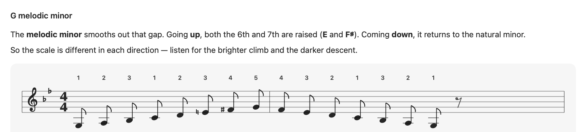

# Piano Coach

A native macOS app that teaches piano through a MIDI keyboard. Plug in a controller, pick a lesson, and the app shows the whole keyboard on screen, lights up the keys to play, listens to what you play, and scores it.

It was built for the 61-key **Novation Launchkey 61**, and works with any MIDI keyboard that macOS can see.


## What it does

- **Shows the full 61-key keyboard** (C2–C7) and lights the keys for each step: blue for the right hand, orange for the left, with finger numbers on the keys.
- **Listens over MIDI** and marks each note green or red as you play.
- **Walks you through 177 lessons** that mix short explanations, a Listen/Demo button, and scored playing tasks.
- **Scores what a teacher would listen for:**
  - note accuracy and wrong notes
  - timing in milliseconds, including whether you rush or drag
  - tempo steadiness
  - velocity evenness and dynamics (pp to ff, crescendo, accents)
  - legato and staccato, measured from key release times
  - voicing (top note of a chord louder) and balance between hands
  - sustain-pedal changes
- **Draws real notation**: treble, bass and grand staff with key signatures, accidentals, rests and fingering, plus a rhythm timeline with a moving playhead.
- **Plays a piano sound** through the Mac, since a MIDI controller makes no sound of its own, and a sample-accurate metronome with a count-in.
- **Saves progress**: stars per lesson and the best clean tempo for each timed task.




## Install and run

Requirements: macOS 14 or later and the Xcode Command Line Tools (`xcode-select --install`). Full Xcode is not needed.

```sh
git clone https://github.com/redbotster/piano-coach.git
cd piano-coach
scripts/build-app.sh --open
```

This builds `build/Piano Coach.app` and opens it. Drag the app to `/Applications` if you want to keep it.

The build is ad-hoc signed, not notarized, so it is meant to be built on the Mac that runs it.

## Using it

1. Connect the keyboard by USB. The toolbar shows a green dot and the device name when it is detected.
2. Choose a lesson in the sidebar, or press **Start** on a section card.
3. Read each step, press **Listen** or **Demo** to hear it, then play.

There are two kinds of playing task:

| Kind | How it works |
|---|---|
| **Untimed** | The lesson waits for you. Play the lit keys in order at your own pace. |
| **Timed** | Press **Start** (or Space). After a count-in, play along with the metronome while the playhead moves. Use the BPM − / + buttons to slow down or speed up. |

After each task you get a result card with the numbers and one to three stars.

### No keyboard handy?

You can click the on-screen keys, or type on the Mac keyboard:

| Keys | Action |
|---|---|
| `A S D F G H J K` | white keys, C to C |
| `W E T Y U` | black keys |
| `Z` / `X` | octave down / up |
| `Space` | start a timed task |
| `⌘→` / `⌘←` | next / previous step |
| `⌘R` | restart the step |
| `⌘D` | play the demo |
| `⌘0` | free play |

Mouse and typed notes use a fixed velocity, so tasks that score dynamics or accents need a real keyboard.

### Launchkey notes

- The Launchkey's keys have no lights. The on-screen keyboard is where keys light up.
- If the wrong octave lights up, press **Octave −/+** on the Launchkey until both buttons are unlit.
- Drum-pad notes (MIDI channel 10) are ignored so they don't collide with the keys.
- Settings has an experimental option to flash the Launchkey's pads green or red for right and wrong notes. It uses the DAW port and has not been tested on hardware.

### Settings

- **Piano sound** on or off (turn it off if a DAW or synth is already sounding).
- **Latency compensation**, for when results always read late, which is common with Bluetooth headphones.
- **Key names** on the on-screen keyboard: off, C only, or all keys.
- **Reset progress.**

## Curriculum

177 lessons in four sections.

### 1. Foundations (19 lessons)

| Unit | Lessons | Covers |
|---|---|---|
| Instrument orientation | 5 | black-key groups, finding every note, octaves and Middle C, the A–G cycle, sharps/flats/enharmonics, half and whole steps |
| Physical setup | 4 | posture and bench height, hand shape, finger numbers, arm weight and relaxation |
| First playing | 8 | five-finger positions in C, G, F, D and A; single-hand melodies; hands alternating; legato and separated notes |
| MIDI skills | 2 | note accuracy, velocity evenness |

### 2. Rhythm & Time (34 lessons)

| Unit | Lessons | Covers |
|---|---|---|
| Pulse & Metronome | 2 | steady pulse, playing with a click |
| Note Values | 4 | whole notes through 32nds |
| Rests, Dots & Ties | 4 | rests for every value, dotted notes, ties |
| Time Signatures & Meter | 7 | 4/4, 3/4, 2/4, cut time, 6/8, 9/8, 12/8, simple vs. compound, counting systems, pickups |
| Syncopation, Tuplets & Swing | 5 | syncopation, triplets, duplets, quintuplets, sextuplets, swing vs. straight |
| Polyrhythms | 2 | 2 against 3, 3 against 4 |
| Tempo & Expressive Timing | 4 | tempo markings, accelerando and ritardando, fermata, rubato |
| Odd & Mixed Meters | 3 | 5/4, 7/8, mixed meters |
| Timing Lab | 3 | onset precision, tempo stability without a click, pattern accuracy |

### 3. Reading Music (31 lessons)

| Unit | Lessons | Covers |
|---|---|---|
| Staff and clefs | 3 | treble clef, bass clef, grand staff |
| Landmarks | 3 | ledger lines, landmark notes, reading by steps and skips |
| Keys and accidentals | 3 | accidentals and how long they last, sharp and flat key signatures |
| Road map | 5 | bar lines, repeats and endings, D.C./D.S./Coda/Fine, 8va/8vb/15ma, clef changes |
| Expression | 4 | dynamics, crescendo/diminuendo/sfz/fp, articulation marks, slurs and phrasing |
| Ornaments and markings | 4 | trills, mordents, turns, grace notes, pedal markings, fingering |
| Sight-reading | 3 | no-stopping sight-reading, reading ahead, pattern recognition |
| Lead sheets | 3 | triads, sevenths and extensions, playing from chord symbols |
| Drills | 3 | note flashcards, key/interval/chord drills, sight-reading sprints |

### 4. Technique (93 lessons)

| Unit | Lessons | Covers |
|---|---|---|
| Basics | 5 | finger independence, thumb-under and finger-over, touch, hands together, contrary and parallel motion |
| Major scales | 12 | all 12 keys with standard fingering |
| Minor scales | 12 | natural, harmonic and melodic in all 12 keys |
| Scale skills | 4 | fingering rules, scales in octaves/3rds/6ths/10ths, contrary motion, chromatic |
| Colour scales | 3 | pentatonic, blues, whole-tone |
| Modes | 7 | Dorian through Locrian |
| Jazz scales | 3 | bebop, altered, diminished |
| Arpeggios | 4 | inversions, dominant and diminished 7ths, hand-over-hand, extended |
| Arpeggios by key | 12 | major and minor triads on every root |
| Patterns | 2 | broken chords, Alberti bass |
| Octaves and double notes | 4 | octave technique, repeated octaves, 3rds, 6ths |
| Agility | 8 | trills, ornaments, repeated notes, leaps, hand crossing, rotation, tremolo, glissando |
| Sound | 3 | voicing, hand balance, polyphonic independence |
| Practice methods | 4 | rhythmic variants, chunking, stamina, injury prevention |
| Exercise traditions | 6 | studies in the style of Hanon, Czerny, Burgmüller, Pischna, Dohnányi, Chopin/Liszt |
| Skill tests | 4 | evenness, clean-speed ladder, timing consistency, voicing |

## Limitations

- **MIDI can't see your body.** Posture, hand shape and relaxation are taught with self-check lists and links to video searches, not verified.
- **Some notation is described, not drawn.** Repeats, D.S./Coda, 8va, slurs and ornament signs are explained in text, then played from a written-out version.
- **Held notes aren't verified.** Held-finger exercises score only the notes you strike.
- **Enharmonic key labels are simplified.** E♯ is labelled F and B♯ is labelled C on the keys.
- **Random sight-reading material** is generated at launch, so it changes each time the app starts rather than on each retry.
- **Testing so far is automated.** Every lesson passes a validity check and the scoring engine passes tests with simulated input, but the lesson text has not been fully proofread and the app has not been tested end to end with a physical keyboard.

## Development

```sh
swift build                                     # debug build
.build/debug/PianoCoach                         # run without packaging
.build/debug/PianoCoach --check -v              # validate every lesson
.build/debug/PianoCoach --selftest              # scoring-engine tests with synthetic input
.build/debug/PianoCoach --snapshot out/ <id>    # render a lesson's steps to PNG
scripts/build-app.sh                            # release build + .app bundle
```

### Project layout

```
Sources/PianoCoach/
  Core/        music theory, lesson model, lesson DSL
  Engine/      CoreMIDI input, piano sound and metronome, scoring, app state
  Views/       keyboard, staff, rhythm lane, lesson screens
  Curriculum/  the lessons
```

There are no third-party dependencies. The app is SwiftUI with CoreMIDI and AVFoundation, built with Swift Package Manager.

### Writing a lesson

Lessons are plain Swift, written with a small DSL (`L`, in `Core/LessonDSL.swift`):

```swift
lesson("foundations.example", "C position", "Five notes under five fingers.", [
    // Explanation with keys lit up
    L.info("The C position", "Thumb on **Middle C**, one finger per key.",
           keys: L.keys("C4 D4 E4 F4 G4", hand: .right)),

    // Untimed: waits for each note, shows finger numbers
    L.play("Up and down", "Follow the lit keys.",
           L.line("C4 D4 E4 F4 G4 F4 E4 D4 C4", fingers: "1 2 3 4 5 4 3 2 1")),

    // Timed: metronome, staff and rhythm timeline, scored for timing and evenness
    L.timed("In time", "One note per click.",
            L.melody("C4:q D4:q E4:h | F4:e G4:e F4:e E4:e D4:h"),
            bpm: 72, display: .staffAndRhythm, rules: [.evenVelocity(maxStdDev: 10)]),
])
```

Rhythm tokens are `w h q e s t` (whole to 32nd), with `.` for dots, `r` for rests, `3`/`5`/`6` prefixes for tuplets, and `~` for ties. Run `--check` after editing; it catches notes off the keyboard, impossible hand spans, duplicate ids and bad timing.

Progress is stored in `~/Library/Application Support/PianoCoach/progress.json`.

## License

[MIT](LICENSE)
